<div align="center">

<picture>
  <source media="(prefers-color-scheme: dark)" srcset=".github/assets/banner-dark.svg">
  
</picture>

<br>

[](https://github.com/reniaz/leise-releases/releases/latest)
[](https://github.com/reniaz/leise-releases/releases)
[](#-download)
[](#-verify-a-download)
[](#-about-leise)

**Signed Leise installers for Windows and Linux.**<br>
This repository holds release files only: the installers, their signatures and the manifest the
built-in updater reads. The source code is private for now.

[Download](#-download) · [Install](#-install) · [Updates](#-updates) · [Verify a download](#-verify-a-download) · [About Leise](#-about-leise)

</div>

> [!WARNING]
> **Leise is a beta (0.1.x).** It works end to end, but it is not finished and has had no outside
> security audit, so don't rely on it yet where your safety depends on it.

## ⬇ Download

Grab the newest build from **[the latest release →](https://github.com/reniaz/leise-releases/releases/latest)**

| System | File | Pick it if |
| --- | --- | --- |
| **Linux** | `Leise_<version>_amd64.AppImage` | you want one file that runs on any distribution and updates itself |
| Linux | `Leise_<version>_amd64.deb` · `Leise-<version>-1.x86_64.rpm` | you'd rather install through your package manager; new versions are installed by hand |
| **Windows** | `Leise_<version>_x64-setup.exe` | you're on Windows 10 or 11; the same small installer is what the updater uses |

Every release also carries `SHA256SUMS`, a `.sig` signature next to each updater file, and
`latest.json`.

## 🧩 Install

**Linux (AppImage)**

```sh
chmod +x Leise_*_amd64.AppImage
./Leise_*_amd64.AppImage
```

**Windows:** run the setup. Leise draws its window with Microsoft's WebView2, which Windows 11 and
current Windows 10 already have; on an older Windows 10 without it, the installer fetches it from
Microsoft first. The installer isn't signed with a Windows code-signing certificate, so
SmartScreen may say it doesn't recognise the app: choose **More info → Run anyway**. If you want to
be sure first, [verify the download](#-verify-a-download).

Leise brings its own I2P router, so there is nothing else to install or configure.

## 🔄 Updates

Leise only looks for updates once you switch it on, in **Settings › Updates › Check for updates ›
GitHub**. It then reads `latest.json` from this repository, downloads the new installer, and checks
its signature against the public key built into the app before installing anything. A file whose
signature doesn't match is refused.

<picture>
  <source media="(prefers-color-scheme: dark)" srcset=".github/assets/updates-dark.svg">
  
</picture>

The signing key never touches GitHub or CI: builds are made without it, and each release is signed
by hand, offline, before it is published here.

> [!NOTE]
> Checking GitHub for updates goes over the regular internet, not I2P, so GitHub sees your IP
> address and when you check. That's why it is off by default. Your chats never take this path;
> they only ever travel over I2P.

## 🔏 Verify a download

**Checksums.** In the folder with the files you downloaded and `SHA256SUMS`:

```sh
sha256sum -c SHA256SUMS --ignore-missing
```

On Windows, compare `Get-FileHash .\Leise_<version>_x64-setup.exe` (PowerShell) with the matching
line in `SHA256SUMS`.

**Signatures.** The AppImage and the Windows installer are signed with
[minisign](https://jedisct1.github.io/minisign/), key ID `DBE889EAC0D37AE6`. The public key is
[`minisign.pub`](minisign.pub) in this repository and is also built into Leise:

```
RWTmetPA6ono2zQluaqG9HJVv8KkO/f+JuUB2pQLBi3jKUleBEg+/1di
```

Each `.sig` file is a minisign signature wrapped in base64, the form the updater reads. Unwrap it,
then verify:

```sh
base64 -d Leise_<version>_amd64.AppImage.sig > Leise_<version>_amd64.AppImage.minisig
minisign -Vm Leise_<version>_amd64.AppImage -x Leise_<version>_amd64.AppImage.minisig -p minisign.pub
```

`Signature and comment signature verified` means the file is exactly what was signed.

## 🤫 About Leise

Community chat that only the people in it can read. Discord-style halls, channels and DMs,
end-to-end encrypted with MLS and Noise, carried over I2P only, with no accounts, no server that can
read you, and themes all the way down. Text chat only. *Leise* is German for "quiet".

The source code is private for now, and this repository doesn't take contributions.
